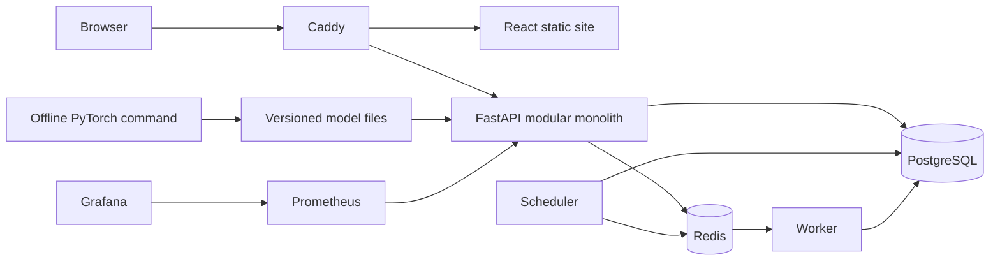
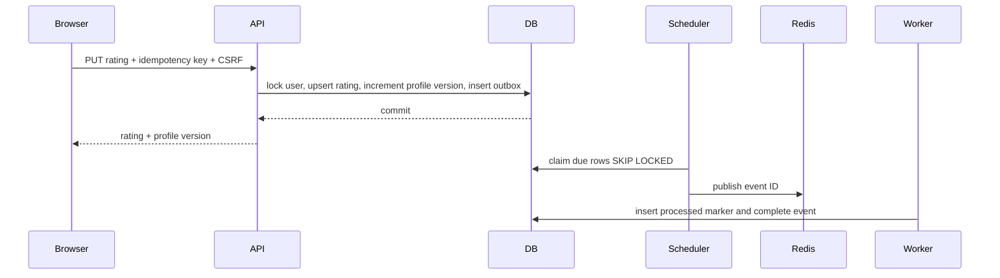

# Architecture

RecSys is a modular monolith. FastAPI modules share one PostgreSQL transaction boundary; Redis is disposable cache/broker state; Celery runs the durable outbox work; React is served through the same origin in production. Offline training reads only imported MovieLens ratings and publishes immutable artifacts.

## Rating and event sequence

The browser never receives source user IDs. Redis failure cannot lose the committed interaction because the outbox is in PostgreSQL. The worker can receive duplicates; `(event_id, consumer)` is unique. Recommendation cache keys include user ID, profile version, active model version, limit, and watchlist behavior. Entries expire after five minutes. A short token-owned Redis reservation coalesces concurrent cold misses; Redis failure remains a direct-scoring, fail-open path.

## Recommendation sequence

For users with ratings, the API loads the single active model registry row, verifies checksums, and constructs an app-user vector from positively rated item embeddings. Negative ratings suppress related embeddings. Anonymous and no-rating requests skip model loading and use deterministic popularity/content ranking. Scores blend collaborative, genre, and popularity signals and filter rated/watchlisted items. A missing, corrupt, or inapplicable artifact returns fallback results with `fallback_reason`; training never runs in a request.

The single-host Compose deployment is a demo architecture with a host-level failure domain. It is not high availability.
